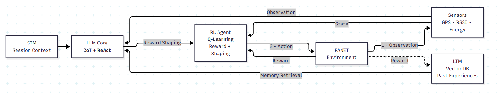

# FANET Multi-UAV Relay Simulation — LLM+RL vs Q-FANET

Simulation of a Flying Ad Hoc Network (FANET): one fixed Source, one fixed Ground Station (GS) and N mobile UAV relays (default 6, tested up to 50). Two routing systems are compared on **identical** traffic, mobility and radio-link snapshots:

| System | Description |
|---|---|
| **LLM+RL (proposed)** | Neighbor-aware Q-learning. An LLM (with STM + LTM memory) scores every reachable next hop; the final action is chosen by Q-learning combined with the LLM scores and a topology/QoS prior. |
| **Q-FANET (baseline)** | QMR-inspired tabular Q-learning, no LLM, no STM/LTM. |



## Architecture

```text
Sensors (GPS, RSSI, Energy) ──observation──► LLM Core (CoT + ReAct) ◄── STM (session context)
                                                  │          ▲
                                                  │          └── LTM (LangSmith + FAISS, past experiences)
                                        neighbor scores / guidance
                                                  ▼
                                   RL Agent (neighbor-aware Q-learning)
                                                  │ action: HOLD | UAV-x | GS
                                                  ▼
                                         FANET Environment
                                                  │ reward R_t, next state S_(t+1)
                                                  ▼
                       Q-update + STM update + LTM save (+ feedback in next LLM prompt)
```

### What the LLM actually does (current code)
The LLM **does not route directly and does not modify the environment reward**. For each UAV with a non-empty queue it returns:
- a score in `[0, 1]` for every currently reachable candidate next hop, and for `HOLD`;
- contextual weights (progress, stability, energy, deadline, congestion);
- a short rationale (the full chain-of-thought stays private and is never exported).

Final decision score per candidate:

```text
Score(a) = 0.35 * Q(s,a) + 0.25 * LLM_score(a) + 0.40 * Topology/QoS_prior(a)
```

Hard safety masks apply before the choice: direct GS is always taken when reachable; if a progress-making neighbor exists, only progress neighbors are allowed; HOLD is allowed only when no useful link exists. The environment reward (QMR-inspired + progress/hop cost) is the only learning signal.

> Note: older versions used bounded FORWARD/HOLD reward shaping. That path (`LLMCore.shape`, `QLearningAgent`) is still in the file but is no longer used.

## Network model

- Area **500 m × 500 m**, hard radio range **180 m** (3-D Euclidean distance).
- Tick = **250 ms**. A packet moves **at most one hop per tick** (synchronous commit).
- Source at `(250, 475, 150)`, GS at `(250, 25, 0)`.
- Gauss-Markov mobility, configurable mean speed (`--speed-mps`, default 12 m/s). UAVs start in a jittered Source→GS corridor.
- Links: in-range pairs follow a Poisson/exponential birth-death process (λ=1.4/s, μ=0.6/s) on **symmetric** edges (`SharedLinkGraph`).
- HELLO beacons every 100 ms (expire after 300 ms) maintain neighbor freshness.
- Source generates DATA at `--packet-rate-pps` (default 10 pps), deadlines drawn from {1000, 1500, 2000, 2500, 3000} ms.
- Each UAV has unlimited queues but a **finite forwarding capacity** (`--relay-capacity-pps`, default 40 pps) with EDF scheduling, so congestion shows up as deadline drops.
- Battery: random 50–100 % start, −3 % per tick, UAV cannot transmit below 1 %.
- Experiment = traffic phase + drain phase (so late packets can still be delivered).

### Fair comparison
Shared: traffic, deadlines, mobility, positions, link snapshot, initial batteries, exploration schedule.
Independent: queues, batteries, drops, Q-tables, decisions.

## Memory
- **STM**: per-UAV, per-session rolling window of the last 5 transitions.
- **LTM**: shared across the swarm. LangSmith dataset (`FANETs`) for persistence, SentenceTransformers + FAISS for semantic retrieval, re-ranked by outcome quality (successful deliveries preferred over deadline failures). Falls back to local lexical retrieval if LangSmith/FAISS is unavailable.

## Project structure

```text
.
├── main.py                    # simulation: LLM+RL, Q-FANET, environment, export
├── neighbor_discovery.py      # SharedLinkGraph, link/energy/distance helpers
├── plot_comparison.py         # sensitivity studies (flow / speed / nodes) -> experiment_results.json
├── multi_run_study.py         # independent runs: variance, boxplot, PDR over time
├── learning_curve_study.py    # sequential runs with persistent Q-tables
├── Dashboard.html             # interactive dashboard
├── run_project.bat            # Windows pipeline launcher
├── Architecure.png            # architecture diagram
├── CORRECTIONS.md             # change log of model corrections
└── requirements.txt
```
Generated: `comparison_results.json`, `exp_*.json`, `experiment_results.json`, `charts/`, `q_tables_*.json`.

## Setup

```bash
python -m venv venv
venv\Scripts\activate          # Linux/macOS: source venv/bin/activate
pip install -r requirements.txt
```

Create a local `.env` (never commit it):

```env
GROQ_API_KEY=
LANGSMITH_API_KEY=
LANGSMITH_ENDPOINT=
LANGSMITH_WORKSPACE_ID=
LTM_DATASET_NAME=FANETs
OLLAMA_MODEL=phi3
OLLAMA_BASE_URL=http://localhost:11434
```

Local LLM backend (default):

```bash
ollama serve
ollama pull phi3
```

## Run

`--uavs` is **required**.

```bash
python main.py --uavs 25 --steps 20 --packet-rate-pps 10 \
    --packet-size-bytes 128 --hello-interval-ms 100 --hello-size-bytes 32
```

Useful options:

| Option | Meaning | Default |
|---|---|---|
| `-n/--uavs` | number of UAV relays (required) | – |
| `-s/--steps` | total ticks (1 tick = 0.25 s) | 20 |
| `--backend` | `ollama`, `groq`, `mixed` | ollama |
| `--packet-rate-pps` | Source DATA rate | 10 |
| `--relay-capacity-pps` | per-UAV forwarding capacity | 40 |
| `--speed-mps` | mean UAV speed | 12 |
| `--output-json` | output file (never use shell `>` redirection) | comparison_results.json |
| `--fresh-learning` | ignore persisted Q-tables | off |

Output: `comparison_results.json` and `charts/pdr_vs_time.png`.

### Sensitivity studies

```bash
python plot_comparison.py --study all --runs 5 --fresh-learning
python -m http.server 8000     # then open http://localhost:8000/Dashboard.html
```

### Variance / learning studies

```bash
python multi_run_study.py 10 30 ollama
python learning_curve_study.py 10 30
```

## Exported data (per run)
`time_s`, `llm_pdr_over_time`, `qfanet_pdr_over_time`, `deadline_trace`, `packet_deadlines`, `packet_tracking` (full per-packet trajectory), `llm_delivery_records`, `qfanet_delivery_records`, `deadline_drop_events`, `battery_trace`, `reward_trace`, `summary`.

## Known limitations
See the "Limitations" discussion in the thesis; main points: small sample sizes in current sweeps, single entry UAV at the Source (bottleneck at high load), idealized MAC/PHY, and the absence of an LLM-ablation baseline.

## Security
`.env` is git-ignored. Rotate any key that was ever committed or shared.
